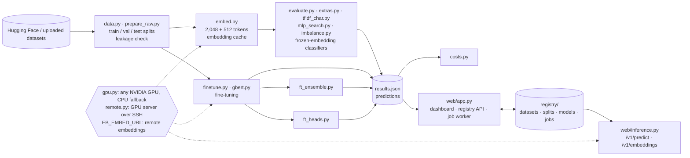

# EmbeddingsBench

How well do modern text embeddings classify text, and what should sit on top of them?
EmbeddingsBench evaluates [`jina-embeddings-v5-text-small-classification`](https://huggingface.co/jinaai/jina-embeddings-v5-text-small-classification)
on public English and German datasets, from short intents to long documents, from 4 to 400+ classes, balanced
and heavily imbalanced. It compares zero-shot label matching, nearest neighbours, linear and non-linear classifiers
on frozen embeddings, TF-IDF baselines, ensembles, class-imbalance schemes and fine-tuning of the encoder itself
(LoRA), plus a German-native reference (gbert-large), all under the same train / validation / test protocol.

It comes with a dashboard for results and individual predictions, a model registry for defining, training and
versioning models, an inference API, and a cost model that predicts GPU and CPU effort for new datasets.

**Dashboard:** https://gorzalniksamuel.github.io/EmbeddingsBench/ (read-only copy; training and the API need a server, see [Deploy](#deploy))

## Findings

Details, figures and recommendations for large and many-class datasets: [report/REPORT.md](report/REPORT.md) ([PDF](report/REPORT.pdf)).

- **A classifier on top is needed.** Matching texts against label names (zero-shot) only works for descriptive
  labels; logistic regression on the frozen embeddings is about 40 points better on average.
- **Logistic regression is the right default on frozen embeddings.** A tuned MLP is +0.3 points on average,
  an RBF SVM −0.9, kNN −6.5; an automatic architecture search mostly settles on shallow networks.
- **Combine embeddings with TF-IDF.** The probability ensemble beats LogReg by more than 0.5 points on 13 of 18 datasets (+3.5 points on
  average) without GPU training, and matches or beats LoRA fine-tuning on 6 of 10.
- **Best jina-based model: fine-tuned jina + TF-IDF** (+3.9 points over frozen LogReg on average). After fine-tuning,
  the classifier on top no longer matters: LogReg, SVM and MLP on the fine-tuned embeddings are within about 1 point of the linear head.
- **German: gbert-large fine-tuned in full beat LoRA-fine-tuned jina** on all three German datasets (1–3 points).
- **Many classes (300+): frozen embeddings alone are not enough.** On 342 food categories and 408 patent classes,
  TF-IDF and the ensembles are 4–16 points ahead of LogReg.
- **Class imbalance:** class weighting raises recall on the rarest third of classes by 3–17 points; the accuracy
  cost grows with the number of classes.
- **Many top results are statistically tied** (95 % bootstrap intervals of ±0.4–1.9 points; ties on 11 of 18
  datasets), so differences below about 1 point should not decide the method.
- **Confidence-based routing works with calibrated models.** With LogReg, 93–100 % of texts on intent, emotion and
  encyclopedia datasets can be classified automatically at 95 % accuracy; TF-IDF ensemble scores need recalibration.
- **Input length and size:** 2,048 instead of 512 tokens only helps on long documents; Matryoshka 512 dimensions
  cost about 1 point.

## Leaderboard

Test accuracy (%) with settings chosen on validation; bold is the best per dataset; `–` = not run.
All metrics (balanced accuracy, macro-F1, MCC, Cohen's κ, top-3 accuracy, tail recall), per-class results and
confusion matrices are in [`results/results.json`](results/results.json) and on the dashboard.

<!-- LEADERBOARD:START -->

Test accuracy (%), results of 12 October 2026 (fine-tuning of the remaining datasets is running). Full analysis, figures and recommendations: [report/REPORT.md](report/REPORT.md) ([PDF](report/REPORT.pdf)). 95 % intervals and statistical ties: dashboard and report.

| Dataset | Lang | Classes | Train | Avg tokens | Zero-shot | kNN | LogReg | RBF SVM | MLP tuned | TF-IDF | TF-IDF char | Emb.+TF-IDF | Emb.+char | Fine-tuned | FT+TF-IDF | gbert-large |
|---|---|---:|---:|---:|---:|---:|---:|---:|---:|---:|---:|---:|---:|---:|---:|---:|
| Yahoo! Answers Topics | EN | 10 | 10,000 | 127 | 23.9 | 49.2 | 67.1 | 65.2 | 67.0 | 64.5 | 65.4 | 70.0 | 70.8 | 71.5 | **72.9** | – |
| DBpedia-14 | EN | 14 | 7,000 | 79 | 67.9 | 98.3 | 98.2 | 98.4 | 98.1 | 96.8 | 96.2 | **98.7** | 98.4 | – | – | – |
| 20 Newsgroups | EN | 20 | 9,361 | 275 | 12.5 | 46.2 | 65.7 | 64.0 | 65.5 | 71.6 | 72.1 | 73.6 | 75.0 | 72.7 | **75.6** | – |
| Banking77 | EN | 77 | 8,497 | 15 | 81.6 | 92.7 | 93.0 | 92.8 | 92.8 | 88.5 | 90.0 | **93.4** | 93.1 | 92.6 | 92.7 | – |
| CLINC150 (in-scope) | EN | 150 | 15,000 | 11 | 37.9 | 87.4 | 92.6 | 92.9 | 92.9 | 91.3 | 91.6 | 94.8 | 94.6 | 95.2 | **95.9** | – |
| arXiv papers (11 categories) | EN | 11 | 8,800 | 4300 | 22.7 | 75.7 | 82.9 | 82.5 | 83.7 | 87.3 | 85.9 | 87.7 | 86.8 | 86.6 | **88.6** | – |
| AG News | EN | 4 | 10,000 | 54 | 49.9 | 81.7 | 87.2 | 87.3 | 87.3 | 89.0 | 89.2 | 90.4 | **90.8** | – | – | – |
| LEDGAR contract clauses (LexGLUE) | EN | 100 | 19,092 | 144 | 4.5 | 69.5 | 74.2 | 76.5 | 76.8 | 81.6 | 80.2 | **81.7** | 80.6 | – | – | – |
| Medical abstracts | EN | 5 | 9,817 | 274 | 31.5 | 61.7 | 70.5 | 71.8 | 71.6 | 75.6 | **77.5** | 76.4 | 77.4 | – | – | – |
| Emotion (tweets) | EN | 6 | 16,000 | 22 | 90.7 | 92.7 | 92.4 | 92.3 | 91.7 | 88.6 | 87.8 | 92.2 | **92.7** | – | – | – |
| 10kGNAD German news | DE | 9 | 7,860 | 732 | 22.9 | 74.3 | 84.1 | 82.4 | 83.3 | 87.4 | 87.5 | 88.7 | 87.8 | 88.6 | 89.9 | **91.5** |
| Amazon reviews DE (stars) | DE | 5 | 10,000 | 65 | 50.7 | 62.1 | 62.2 | 62.2 | 62.2 | 54.6 | 53.5 | 63.0 | 63.3 | 63.6 | 63.7 | **64.7** |
| MASSIVE intents DE | DE | 60 | 11,514 | 12 | 80.3 | 87.2 | 87.0 | 86.9 | 87.1 | 78.6 | 82.6 | 87.3 | 87.4 | 87.0 | 87.3 | **88.0** |
| GermEval 2018 offensive language | DE | 4 | 4,258 | 45 | 36.2 | 69.0 | 70.2 | 69.4 | 70.1 | 67.5 | 70.8 | 71.0 | 70.8 | **73.9** | 72.9 | – |
| MTOP intents DE | DE | 103 | 11,072 | 14 | 64.9 | 94.5 | 94.5 | **94.8** | 94.4 | 90.7 | 91.9 | 94.4 | 94.4 | 94.3 | – | – |
| Swiss Federal Supreme Court decisions DE (legal area) | DE | 47 | 25,737 | 3413 | 6.9 | 81.9 | 89.0 | 89.6 | 89.5 | 92.2 | 93.4 | 93.3 | **93.7** | – | – | – |
| Open Food Facts DE (product categories) | DE | 342 | 69,366 | 18 | 2.0 | 26.1 | 44.9 | 35.5 | 46.4 | 57.8 | 60.5 | 58.6 | **60.6** | – | – | – |
| HUPD patents (IPC subclass) | EN | 408 | 98,195 | 151 | 0.4 | 39.0 | 50.2 | 45.1 | 50.8 | 52.3 | – | **54.3** | – | – | – | – |

<!-- LEADERBOARD:END -->

## Architecture



| Path | Purpose |
|---|---|
| `bench/data.py`, `bench/prepare_raw.py` | Dataset specs, raw-data cleaning, split building (per-class caps, official or held-out validation, duplicate removal, uploaded datasets). |
| `bench/embed.py` | Embeddings with length-sorted, memory-sized batches; 2,048- and 512-token variants; local or remote (`EB_EMBED_URL`). |
| `bench/evaluate.py` | Main benchmark: classifiers with validation-based selection, learning curves, 512-token ablation, per-item predictions. |
| `bench/extras.py`, `bench/tfidf_char.py` | RBF SVM, embedding + TF-IDF ensembles (word and character n-grams), Matryoshka truncation. |
| `bench/mlp_search.py` | Automatic bias–variance search for an MLP (Optuna TPE), train vs. validation accuracy per trial. |
| `bench/imbalance.py` | Class-weighted LogReg and MLP, balanced batches, logit adjustment; tail recall. |
| `bench/finetune.py`, `bench/gbert.py`, `bench/ft_ensemble.py` | LoRA fine-tuning (weighted / logit-adjusted losses, head + tail truncation), gbert-large, fine-tuned + TF-IDF ensembles. |
| `bench/ft_heads.py` | The classifier sweep (kNN, LogReg, RBF SVM, tuned MLP) repeated on the fine-tuned encoder's embeddings. |
| `bench/report.py` | Figures and tables for the findings report (`report/`). |
| `bench/export_benchmark_models.py` | Registers the benchmark's selected classifiers as registry models (servable by the inference API). |
| `bench/gpu.py` | Device, precision (bf16 / fp16 / fp32), memory-sized batches, out-of-memory back-off, CPU fallback. |
| `bench/remote.py` | Runs any GPU script on another machine over SSH and syncs the results back. |
| `bench/registry.py`, `bench/jobs.py` | Versioned datasets, splits and models; job queue and worker; CLI. |
| `bench/classifiers/` | Classifier plugins (new model types). |
| `bench/inference.py`, `web/inference.py` | Inference service: predictions from any registry model, embedding endpoint, OpenAPI description. |
| `clients/` | OpenAPI spec and the .NET client library (`clients/dotnet`). |
| `bench/costs.py` | Parameter counts, measured effort and fitted scaling rules. |
| `bench/package_models.py` | Release archives of all trained models and the model table. |
| `web/app.py`, `web/template.html` | Dashboard server (static files, registry API, job worker) and the single-page dashboard. |
| `web/build_site.py` | Static, read-only export (GitHub Pages) with licence-aware text removal. |
| `results/`, `docs/` | Published results and the published static dashboard. |

### Protocol

- Settings (C, k, network size, epochs, ensemble weights, fine-tuning checkpoint) are chosen on validation; test is scored once.
  Imbalance schemes are selected on validation macro-F1.
- Validation: the official split where one exists, otherwise a stratified hold-out from the official training split.
- Validation/test texts that duplicate a training text (case- and whitespace-normalised) are removed; classes that
  never occur in train are removed from validation and test.
- Large datasets cap only their head classes in train, so the natural imbalance stays; validation and test stay natural.
- Seed 13 for all sampling and training.

## Deploy

**Hardware.** Any NVIDIA GPU with CUDA works; `bench/gpu.py` picks the GPU with the most free memory (or `EB_GPU`),
uses bf16 on Ampere and newer and fp16 with gradient scaling on older cards, sizes batches by free memory and halves
them on out-of-memory. Fine-tuning needs about 3.6 GiB at 512 tokens; gbert-large about 7 GiB. Without a GPU
everything runs on the CPU (embedding and fine-tuning slowly), or uses a GPU server elsewhere (below).
About 20 GB of disk for datasets, embeddings and the Hugging Face cache.

```bash
git clone https://github.com/gorzalniksamuel/EmbeddingsBench.git && cd EmbeddingsBench
python3.12 -m venv .venv
.venv/bin/pip install torch==2.8.0 --index-url https://download.pytorch.org/whl/cu128   # or the CPU wheel
.venv/bin/pip install -r requirements.txt
cp .env.example .env            # paths, bind addresses, GPU and remote settings
.venv/bin/python bench/gpu.py   # shows the device, precision and batch budget that will be used
```

**Run the benchmark** (several hours on a 12 GB consumer GPU, most of it fine-tuning):

```bash
bench/run_benchmark.sh
```

Single steps run on their own, e.g. `cd bench && python evaluate.py ag_news` adds one dataset to an existing
`results.json`, `python finetune.py gnad10 --loss weighted --key finetune_weighted` fine-tunes one variant, and
`bench/add_datasets.sh <names>` builds and benchmarks newly defined datasets only.

**Run the dashboard and the job worker:**

```bash
.venv/bin/python web/app.py         # http://127.0.0.1:8095 (EB_BIND / EB_PORT); runs queued jobs one at a time
.venv/bin/python bench/jobs.py worker   # alternatively: only the job worker, e.g. on a headless GPU box
```

As services: [`deploy/embeddingsbench.service`](deploy/embeddingsbench.service) and
[`deploy/embeddingsbench-inference.service`](deploy/embeddingsbench-inference.service).
The dashboard API has **no authentication**: keep `EB_BIND` on localhost or a private network, or put it behind a
reverse proxy with authentication.

**Static copy (GitHub Pages):** `python web/build_site.py docs` exports a read-only dashboard into `docs/`. Texts of
datasets whose licence does not allow redistribution are left out; predictions and metrics stay.

### Using a GPU server elsewhere

- **Remote embeddings:** run the inference service (below) on the GPU server and set `EB_EMBED_URL=http://gpu-host:8096`
  (and `EB_API_KEY`) on the other machine. Every embedding step (benchmark, registry, uploads, inference) then sends
  texts to `/v1/embeddings` instead of loading the model. Any OpenAI-compatible endpoint serving the same model works.
- **Remote jobs:** set `EB_REMOTE_HOST=user@gpu-host` (plus `EB_REMOTE_DIR`, `EB_REMOTE_PYTHON`, `EB_SSH_OPTS`).
  `python bench/remote.py finetune.py gnad10` syncs code and data to the server with rsync, runs the script there with
  its own GPU and `.env`, and syncs results, models, embeddings and the registry back. With `EB_REMOTE_HOST` set, the
  job worker runs every registry job this way, so the dashboard can live on a small machine.

## Inference API

```bash
EB_API_KEY=secret .venv/bin/python web/inference.py     # http://127.0.0.1:8096 (EB_INFER_BIND / EB_INFER_PORT)
```

| Endpoint | Method | Purpose |
|---|---|---|
| `/health` | GET | device and configuration |
| `/v1/models` | GET | ready registry models: `name:version`, method, dataset, required input, test accuracy |
| `/v1/predict` | POST | `{"model": "name[:version]", "embeddings": [[…1,024 floats…]] or "texts": ["…"], "top_k": 3, "distribution": true}` |
| `/v1/embeddings` | POST | OpenAI-compatible: `{"input": ["…"]}` → L2-normalised 1,024-d embeddings (the benchmark encoder with the `Document: ` prompt) |

```bash
curl -s -H "Authorization: Bearer secret" -H "Content-Type: application/json" localhost:8096/v1/predict \
  -d '{"model": "banking-logreg", "texts": ["My card has not arrived yet"], "top_k": 3}'
```

Each prediction returns `label` (readable), `label_id`, `index`, `confidence`, `top_k` and, with `distribution`, the
probability of every class. Classifiers on frozen embeddings accept embeddings or texts; TF-IDF, ensembles and
fine-tuned models need texts.

### .NET applications

[`clients/dotnet`](clients/dotnet) contains `EmbeddingsBench.Client`, a .NET 8 library with typed models,
`PredictAsync` / `EmbedAsync` / `ListModelsAsync` and `services.AddEmbeddingsBench(...)` for dependency injection
(IHttpClientFactory), plus an example app. The OpenAPI description at `/openapi.yaml`
([`clients/openapi.yaml`](clients/openapi.yaml)) lets NSwag or Kiota generate clients for other stacks.

```csharp
builder.Services.AddEmbeddingsBench(o => { o.BaseAddress = new("http://gpu-host:8096"); o.ApiKey = "…"; });
var p = await bench.PredictOneAsync("banking-logreg", "My card has not arrived yet");   // p.Label, p.Confidence, p.TopK
```

## Model registry

The **Models** and **Data** tabs and the CLI manage versioned datasets, splits and models; every finished training
(including benchmark runs of `finetune.py` and `gbert.py`) appears in the Models tab as a version with its split,
settings, validation selection, test metrics, confusion matrix, parameters, training effort and artifacts.

```bash
cd bench
python jobs.py split banking77 --title "20 per class" --train-per-class 20 --val holdout:10 --seed 7
python jobs.py train banking-logreg --dataset banking77 --method logreg --description "Baseline"
python jobs.py train banking-mlp --dataset banking77 --method mlp          # automatic bias–variance search
python jobs.py retrain banking-logreg 1 --split s2                          # new version on another split
python jobs.py describe banking-logreg 2 --stage production --tags few-shot
python jobs.py list
```

| Endpoint | Method | Purpose |
|---|---|---|
| `/api/state` | GET | datasets with splits, models, jobs, available classifiers |
| `/api/datasets` | POST | upload a dataset `{name, title, lang, domain, description, format, content, benchmark}` |
| `/api/splits` | POST | create a split `{dataset, title, description, train_per_class, test_per_class, val: {mode, value}, seed}` |
| `/api/models` | POST | train `{name, dataset, split, method, params, description, tags}`; an existing name creates a new version |
| `/api/models/<name>/<v>` | GET | full model record |
| `/api/models/<name>/<v>/retrain` | POST | new version from `v`, optionally with another `split` or `params` |
| `/api/models/<name>/<v>/describe` | POST | update `description`, `tags`, `stage` |
| `/api/jobs/<id>/log`, `/api/jobs/<id>/cancel` | GET / POST | job log, cancel a job |

## Extending

**Add a dataset.** A CSV or JSONL file with the columns `text` and `label`, optionally `split`
(`train` / `validation` / `test`; without it the rows are split 80/10/10, stratified). Upload it on the **Data** tab
or run `python jobs.py add-dataset support-tickets tickets.csv --title "Support tickets" --lang de --benchmark`.
Duplicates and classes with fewer than 3 examples are removed and the texts are embedded; the dataset is then
available for training, and with `--benchmark` also on the Overview. Built-in datasets are defined in `SPECS` in
`bench/data.py`; datasets that need cleaning get a preparer in `bench/prepare_raw.py`.

**Add a model type.** Put a module into `bench/classifiers/` that defines `NAME`, `LABEL`, `DESCRIPTION`, `INPUT`
(`"embeddings"` or `"text"`), `PARAMS`, `GRID`, `fit(params, train)` and `predict_proba(model, split)`. It is
discovered automatically by the registry, the training form, the CLI (`--method`) and the inference API;
[`nearest_centroid.py`](bench/classifiers/nearest_centroid.py) and [`tfidf_logreg.py`](bench/classifiers/tfidf_logreg.py)
are templates.

**Define a model.** Any classifier + dataset + split + settings combination is a model: train it on the Models tab
or with `python jobs.py train <name> --dataset … --method … [--params '{"C": 10}']`.

## Models

All trained models are attached to the [GitHub release](https://github.com/gorzalniksamuel/EmbeddingsBench/releases);
[`models/README.md`](models/README.md) lists them with their scores:

- `finetuned-<dataset>[-variant].tar.gz`: the fine-tuned layers of the encoder (LoRA adapters on all attention and
  MLP projections, about 37 MB) plus the classification head; the base model is downloaded from Hugging Face.
- `finetuned-<dataset>-gbert.tar.gz`: fully fine-tuned gbert-large models (about 1.3 GB).
- `registry-models.tar.gz`: every registry model (LogReg, MLP, kNN settings, plugins …) with its metadata.

```python
import sys; sys.path.insert(0, "bench")
from finetune import load_finetuned
classify, model, tokenizer, info = load_finetuned("models/gnad10")      # unpacked from finetuned-gnad10.tar.gz
classify(["Der DAX schloss am Freitag mit einem Plus von zwei Prozent."])   # -> [(label, probability)]
```

## Cost and scaling

The **Cost** tab lists trainable and stored parameters per classifier, the measured training effort, and scaling
rules fitted to the runs, with a calculator for new datasets:

- GPU embedding time grows linearly with the number of tokens and does not depend on the number of classes.
- Fine-tuning time grows with epochs × training texts × tokens per text (capped at 512). Classes only add 1,024
  weights each to the head; memory is set by the batch size, not by the dataset.
- CPU classifiers follow their algorithm's complexity (LogReg and linear SVM ∝ texts × classes, MLP ∝ texts,
  RBF SVM ∝ texts²), with the constant calibrated on the benchmark.

Times were measured on a 4-core VM with an RTX 3060 (12 GB) shared with other services; treat them as approximate.

## Licences

The source code is MIT-licensed. Model weights and datasets keep their own licences; models trained on
non-commercial data are released for non-commercial use.

| Component | Licence | Texts in the public dashboard |
|---|---|---|
| jina-embeddings-v5-text-small-classification | CC BY-NC 4.0 | – |
| Fine-tuned adapters (release) | CC BY-NC 4.0 (derived from the model above) | – |
| deepset/gbert-large | MIT | – |
| DBpedia-14 | CC BY-SA 3.0 | yes |
| 20 Newsgroups | public research corpus | yes |
| Banking77 | CC BY 4.0 | yes |
| CLINC150 | CC BY 3.0 | yes |
| LEDGAR (LexGLUE) | CC BY 4.0 | yes |
| Medical abstracts | CC BY-SA 3.0 | yes |
| 10kGNAD | CC BY-NC-SA 4.0 | yes |
| MASSIVE (de-DE) | CC BY 4.0 | yes |
| Swiss Federal Supreme Court decisions | CC0 | yes |
| Open Food Facts | ODbL | yes |
| Yahoo! Answers Topics | Yahoo Webscope terms | no (predictions only) |
| arXiv classification | paper copyrights | no (predictions only) |
| AG News | non-commercial research use | no (predictions only) |
| Emotion | research use | no (predictions only) |
| Amazon Reviews (MARC, de) | Amazon MARC terms | no (predictions only) |
| HUPD (patents) | CC BY-SA 4.0 (original); mirror without stated licence | no (predictions only) |
| MTOP (de) | CC BY-SA 4.0 (original); mirror without stated licence | no (predictions only) |
| GermEval 2018 | research use | no (predictions only) |

## References

- Jina AI, *jina-embeddings-v5-text: Distilling 4B Quality into Sub-1B Multilingual Embeddings*, arXiv:2602.15547.
- Menon et al., *Long-tail learning via logit adjustment*, ICLR 2021.
- Datasets via the Hugging Face Hub: `community-datasets/yahoo_answers_topics`, `fancyzhx/dbpedia_14`,
  `SetFit/20_newsgroups`, `mteb/banking77`, `clinc/clinc_oos`, `ccdv/arxiv-classification`, `fancyzhx/ag_news`,
  `coastalcph/lex_glue` (ledgar), `TimSchopf/medical_abstracts`, `dair-ai/emotion`, `community-datasets/gnad10`,
  `mteb/AmazonReviewsClassification` (de), `mteb/MassiveIntentClassification` (de), `late-interacters/hupd-2007`,
  `openfoodfacts/product-database`, `mteb/mtop_intent` (de), `voilaj/swiss-caselaw`, `philschmid/germeval18`.
