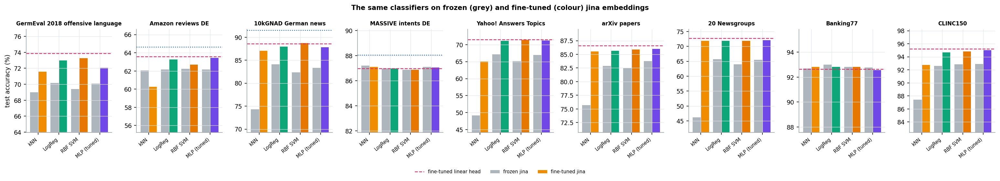

# EmbeddingsBench — findings

**Text classification with `jinaai/jina-embeddings-v5-text-small-classification`: classifiers on frozen embeddings, TF-IDF, ensembles, LoRA fine-tuning and a German-native reference model on 18 English and German datasets.**

Status: results as of 12 October 2026, 11:00 UTC. Fine-tuning of the remaining 10 datasets and the imbalance fine-tunes are still running (see the end); the report and the dashboard are updated when they finish. All accuracies are on held-out test splits; every setting (C, k, MLP shape, ensemble weight, fine-tuning checkpoint) was chosen on the validation split only.

## Key findings

1. **Logistic regression is the right default on frozen embeddings.** Across 18 datasets a tuned MLP is on average +0.3 points better (median 0.0), an RBF SVM −0.9, kNN −6.5. A 40-trial MLP architecture search mostly settles on shallow networks (depth 0–1 on 13 of 18 datasets) whose gain over LogReg is within noise.
2. **The cheapest real gain is an ensemble with TF-IDF.** Averaging LogReg probabilities with a word-n-gram TF-IDF SVM beats LogReg by more than 0.5 points on 13 of 18 datasets, +3.5 points on average, with no GPU training. It matches or beats LoRA fine-tuning on 4 of the 6 datasets where both were run.
3. **The best jina-based classifier is fine-tuned jina + TF-IDF**: +4.8 points over frozen LogReg on average (Yahoo! 72.9 %, arXiv 88.6 %, 20 Newsgroups 75.6 %, 10kGNAD 89.9 %). Fine-tuning and lexical features are complementary.
4. **After fine-tuning, the classifier on top no longer matters.** LogReg, RBF SVM and a tuned MLP on the fine-tuned encoder's embeddings land within about 1 point of its jointly trained linear head (the MLP search chose a linear model on all six datasets). kNN trails LogReg by up to 20 points on frozen embeddings, but only by 0–6 points after fine-tuning, because fine-tuning pulls each class together.
5. **For German, a German-native encoder fine-tuned in full is stronger.** `gbert-large` beat LoRA-fine-tuned jina on all three German datasets: 10kGNAD 91.5 vs 88.6 % (89.9 % with TF-IDF), Amazon reviews 64.7 vs 63.6 %, MASSIVE 88.0 vs 87.0 %. It needed 21–42 min of training and under 4 GiB of GPU memory per dataset (8-bit AdamW).
6. **Frozen embeddings struggle with many fine-grained classes.** With 342 food categories (Open Food Facts DE) LogReg reaches 44.9 % while TF-IDF reaches 57.8 % and the ensemble with character n-grams 60.6 %. For 408 patent classes (HUPD): 50.2 / 52.3 / 54.3 %. Intent datasets with 60–150 classes are the exception (87–95 %), because their classes differ in meaning, not in vocabulary.
7. **Long, technical or legal texts favour lexical features.** On Swiss court decisions, arXiv and LEDGAR, TF-IDF alone beats LogReg on frozen embeddings by 3–7 points and is within 1.5 points of the best method.
8. **Class weighting buys rare-class recall; the price grows with the number of classes.** Tail recall (the third of classes with the fewest training examples): MTOP 27.9 → 36.8 % at equal accuracy, Swiss decisions 79.4 → 87.7 % (−1.5 points accuracy), Open Food Facts 36.4 → 46.8 % (−2.4), HUPD 12.6 → 29.8 % (−5.9).
9. **Zero-shot (label-name similarity) only works when label names are descriptive**: 91 % on emotions, 82 % on banking intents, under 10 % on legal areas, patents and product categories.
10. **2,048-token input only matters when most texts are long** (Swiss decisions +2.2, 10kGNAD +0.9, arXiv +0.5 points vs 512 tokens); for fine-tuning, head + tail truncation helped more than 1,024 tokens (10kGNAD 89.6 vs 88.8 %). **Matryoshka truncation to 512 dimensions costs 1.1 points on average** (at most 3.1), 256 dimensions 2.8 points.

## Setup

- **Encoder:** `jinaai/jina-embeddings-v5-text-small-classification` (revision `4447914`), last-token pooling, L2-normalised 1,024-d embeddings, prompt `Document: `, up to 2,048 tokens.
- **Classifiers on frozen embeddings:** zero-shot (cosine similarity to label-name embeddings), kNN (cosine, k tuned), logistic regression (C tuned), RBF SVM, MLP (1–2 GELU layers) and a 40-trial MLP architecture search.
- **Text baselines:** TF-IDF (word 1–2-grams, sublinear tf) with a linear SVM; character 2–5-gram TF-IDF.
- **Ensembles:** weighted average of LogReg probabilities and softmaxed TF-IDF scores; weight and temperature chosen on validation.
- **Fine-tuning:** LoRA rank 16 on all attention and MLP projections, linear head initialised from the frozen LogReg, 3 epochs, 512 tokens (variants: 1,024 tokens, head + tail truncation, class-weighted and logit-adjusted loss), plus an ensemble with TF-IDF and the full classifier sweep on the fine-tuned embeddings. `deepset/gbert-large` fully fine-tuned as a German reference (8-bit AdamW, effective batch 16, 3 epochs).
- **Metrics:** accuracy, balanced accuracy, macro-F1, MCC, Cohen's κ, top-3 accuracy and tail recall (recall on the third of classes with the fewest training examples).
- **Hardware:** one RTX 3060 (12 GB), shared with other services.
- **Method categories** (as grouped in the dashboard): frozen jina + classifier · frozen jina with imbalance schemes · text only (TF-IDF) · ensembles of frozen embeddings and TF-IDF · fine-tuned jina (LoRA) · classifiers on fine-tuned jina embeddings · other model (gbert-large).

## Datasets

| Dataset | Lang | Domain | Classes | Train / val / test | Avg tokens | Train imbalance |
|---|---|---|---|---|---|---|
| GermEval 2018 offensive language | DE | tweets (offensive language) | 4 | 4,258 / 751 / 3,398 | 45 | 47:1 |
| Amazon reviews DE (stars) | DE | product reviews (sentiment) | 5 | 10,000 / 5,000 / 4,999 | 65 | 1:1 |
| 10kGNAD German news | DE | news | 9 | 7,860 / 1,384 / 1,027 | 732 | 3:1 |
| Swiss Federal Supreme Court decisions DE (legal area) | DE | court decisions | 47 | 25,737 / 3,002 / 3,002 | 3413 | 19:1 |
| MASSIVE intents DE | DE | assistant intents | 60 | 11,514 / 1,943 / 2,845 | 12 | 202:1 |
| MTOP intents DE | DE | assistant intents (long tail) | 103 | 11,072 / 1,956 / 1,756 | 14 | 1175:1 |
| Open Food Facts DE (product categories) | DE | food products | 342 | 69,366 / 8,790 / 8,790 | 18 | 12:1 |
| AG News | EN | news | 4 | 10,000 / 2,000 / 7,599 | 54 | 1:1 |
| Medical abstracts | EN | medical | 5 | 9,817 / 1,221 / 1,878 | 274 | 3:1 |
| Emotion (tweets) | EN | emotion (tweets) | 6 | 16,000 / 1,995 / 1,986 | 22 | 9:1 |
| Yahoo! Answers Topics | EN | community Q&A | 10 | 10,000 / 2,000 / 5,000 | 127 | 1:1 |
| arXiv papers (11 categories) | EN | scientific papers | 11 | 8,800 / 2,446 / 2,441 | 4300 | 1:1 |
| DBpedia-14 | EN | encyclopedia | 14 | 7,000 / 1,400 / 2,800 | 79 | 1:1 |
| 20 Newsgroups | EN | forum posts | 20 | 9,361 / 1,644 / 7,299 | 275 | 2:1 |
| Banking77 | EN | banking intents | 77 | 8,497 / 1,496 / 3,069 | 15 | 5:1 |
| LEDGAR contract clauses (LexGLUE) | EN | legal contracts | 100 | 19,092 / 9,914 / 9,855 | 144 | 9:1 |
| CLINC150 (in-scope) | EN | assistant intents | 150 | 15,000 / 2,997 / 4,498 | 11 | 1:1 |
| HUPD patents (IPC subclass) | EN | patents (IPC subclasses, long tail) | 408 | 98,195 / 18,934 / 18,901 | 151 | 50:1 |

Splits are fixed and stratified where the source has none; large sources are capped per class (see `bench/data.py`). Train imbalance is the ratio of the largest to the smallest class in the training split.

## Overview

| Dataset | Classes | Zero-shot | kNN | LogReg | MLP | TF-IDF | Emb.+TF-IDF | Best (method) | Macro-F1 of best |
|---|---|---|---|---|---|---|---|---|---|
| GermEval 2018 offensive language | 4 | 36.2 | 69.0 | 70.2 | 70.3 | 67.5 | 71.0 | **71.0** (Emb.+TF-IDF) | 34.9 |
| Amazon reviews DE | 5 | 50.7 | 62.1 | 62.2 | 62.0 | 54.6 | 63.0 | **64.7** (gbert-large) | 64.6 |
| 10kGNAD German news | 9 | 22.9 | 74.3 | 84.1 | 83.7 | 87.4 | 88.7 | **91.5** (gbert-large) | 91.5 |
| Swiss Federal Supreme Court decisions DE | 47 | 6.9 | 81.9 | 89.0 | 89.0 | 92.2 | 93.3 | **93.7** (Emb.+char TF-IDF) | 89.4 |
| MASSIVE intents DE | 60 | 80.3 | 87.2 | 87.0 | 87.0 | 78.6 | 87.3 | **88.0** (gbert-large) | 84.1 |
| MTOP intents DE | 103 | 64.9 | 94.5 | 94.5 | 94.6 | 90.7 | 94.4 | **94.8** (RBF SVM) | 83.2 |
| Open Food Facts DE | 342 | 2.0 | 26.1 | 44.9 | 45.4 | 57.8 | 58.6 | **60.6** (Emb.+char TF-IDF) | 56.9 |
| AG News | 4 | 49.9 | 81.7 | 87.2 | 86.9 | 89.0 | 90.4 | **90.8** (Emb.+char TF-IDF) | 90.7 |
| Medical abstracts | 5 | 31.5 | 61.7 | 70.5 | 72.0 | 75.6 | 76.4 | **77.5** (TF-IDF char) | 77.2 |
| Emotion | 6 | 90.7 | 92.7 | 92.4 | 92.3 | 88.6 | 92.2 | **92.7** (Emb.+char TF-IDF) | 88.1 |
| Yahoo! Answers Topics | 10 | 23.9 | 49.2 | 67.1 | 67.6 | 64.5 | 70.0 | **72.9** (Fine-tuned jina + TF-IDF) | 72.5 |
| arXiv papers | 11 | 22.7 | 75.7 | 82.9 | 82.8 | 87.3 | 87.7 | **88.6** (Fine-tuned jina + TF-IDF) | 87.9 |
| DBpedia-14 | 14 | 67.9 | 98.3 | 98.2 | 98.2 | 96.8 | 98.7 | **98.7** (Emb.+TF-IDF) | 98.7 |
| 20 Newsgroups | 20 | 12.5 | 46.2 | 65.7 | 65.5 | 71.6 | 73.6 | **75.6** (Fine-tuned jina + TF-IDF) | 74.0 |
| Banking77 | 77 | 81.6 | 92.7 | 93.0 | 92.1 | 88.5 | 93.4 | **93.4** (Emb.+TF-IDF) | 93.3 |
| LEDGAR contract clauses | 100 | 4.5 | 69.5 | 74.2 | 75.1 | 81.6 | 81.7 | **81.7** (Emb.+TF-IDF) | 77.6 |
| CLINC150 | 150 | 37.9 | 87.4 | 92.6 | 92.3 | 91.3 | 94.8 | **94.8** (Emb.+TF-IDF) | 94.8 |
| HUPD patents | 408 | 0.4 | 39.0 | 50.2 | 50.4 | 52.3 | 54.3 | **54.3** (Emb.+TF-IDF) | 38.7 |

The best method per dataset is picked by test accuracy for this overview; each method's own settings were chosen on validation. On GermEval 2018 and the long-tail sets (MTOP, HUPD), macro-F1 is far below accuracy: the majority classes dominate accuracy.

## Classifiers on top of the embeddings

Test accuracy difference to LogReg on frozen embeddings, in points:

| Classifier | Mean Δ (pts) | Median Δ (pts) | Better by > 0.5 pts | Datasets |
|---|---|---|---|---|
| FT+TF-IDF | +4.8 | +5.7 | 5 | 6 |
| Emb.+TF-IDF | +3.5 | +3.0 | 13 | 18 |
| Fine-tuned | +3.5 | +4.0 | 5 | 6 |
| TF-IDF | +0.5 | +0.3 | 9 | 18 |
| MLP (tuned) | +0.3 | +0.0 | 5 | 18 |
| RBF SVM | -0.9 | -0.1 | 3 | 18 |
| kNN | -6.5 | -5.3 | 0 | 18 |
| Zero-shot | -39.9 | -40.9 | 0 | 18 |

- **LogReg vs MLP:** the embeddings are already linearly separable where they separate at all. A tuned MLP gains more than 0.5 points on only 5 of 18 datasets (most on LEDGAR, +2.6) and small amounts on the many-class sets (Open Food Facts +1.5, HUPD +0.6, Swiss decisions +0.5). The search chose depth 0 on 4 datasets, depth 1 on 9, depth 2–3 on 5.
- **RBF SVM:** never clearly better than LogReg, slower to train (a 30k subsample was needed above 30k training texts) and on Open Food Facts 9 points worse.
- **kNN:** competitive on intents and emotions (within 0.5 points of LogReg on Banking77, MTOP, MASSIVE, Emotion), weak on topical and many-class data (−18 points on Yahoo!, −19 on Open Food Facts).
- **Zero-shot:** useful as a no-label starting point only where label names describe the class well.

## Number of classes and text length

Accuracy on frozen embeddings drops sharply above about 150 classes, while TF-IDF degrades less: a single 1,024-d embedding appears to blur fine distinctions between neighbouring product or patent categories that specific words and word parts still separate. Text length alone is not the driver: short intent texts are classified well and short product names badly.

## How many labels are needed

With 8–16 examples per class, LogReg on frozen embeddings already reaches most of its full-data accuracy on intent, emotion and encyclopedia data (Banking77 ~92 % at 16 per class, DBpedia ~98 % at 4). Topical and many-class datasets keep improving up to the full training set; there, more labels pay off more than a different classifier. LogReg is mostly ahead of the MLP at small sample sizes.

## Fine-tuning

| Dataset | Frozen LogReg | Fine-tuned | Best without GPU training | FT + TF-IDF | gbert-large | Train minutes |
|---|---|---|---|---|---|---|
| Amazon reviews DE | 62.2 | 63.6 | 63.3 | 63.7 | 64.7 | 37 |
| 10kGNAD German news | 84.1 | 88.6 | 88.7 | 89.9 | 91.5 | 76 |
| MASSIVE intents DE | 87.0 | 87.0 | 87.4 | 87.3 | 88.0 | 26 |
| Yahoo! Answers Topics | 67.1 | 71.5 | 70.8 | 72.9 | – | 39 |
| arXiv papers | 82.9 | 86.6 | 87.7 | 88.6 | – | 150 |
| 20 Newsgroups | 65.7 | 72.7 | 75.0 | 75.6 | – | 46 |

- Fine-tuning pays off where classes are topical and the frozen embedding is not tuned to the distinction (Yahoo!, 20NG, news). On MASSIVE the best checkpoint was step 0, i.e. the untouched encoder.
- Fine-tuned jina alone beats the best classifier without GPU training on only 2 of 6 datasets; **combined with TF-IDF it is ahead on 5 of 6** (+0.4 to +2.1 points).
- 10kGNAD variants: head + tail truncation (first 384 + last 128 tokens) 89.6 %, 1,024 tokens 88.8 %, 512 tokens 88.6 %.
- `gbert-large` (335M parameters, all weights trained) is the best model on every German dataset where it ran. It is a different encoder, so its predictions cannot reuse stored jina embeddings.

## Classifiers on fine-tuned embeddings

Does it pay to run the classifier sweep again after fine-tuning? The fine-tuned encoder's pooled, normalised embeddings were computed for train / val / test, and the same classifiers with the same grids were fitted on them.

| Dataset | Frozen kNN | Frozen LogReg | Frozen RBF SVM | Frozen MLP (tuned) | FT-emb kNN | FT-emb LogReg | FT-emb RBF SVM | FT-emb MLP (tuned) | Fine-tuned | gbert-large |
|---|---|---|---|---|---|---|---|---|---|---|
| Amazon reviews DE | 62.1 | 62.2 | 62.2 | 62.2 | 60.3 | 63.3 | 62.7 | 63.5 | 63.6 | 64.7 |
| 10kGNAD German news | 74.3 | 84.1 | 82.4 | 83.3 | 87.0 | 87.9 | 88.7 | 87.8 | 88.6 | 91.5 |
| MASSIVE intents DE | 87.2 | 87.0 | 86.9 | 87.1 | 87.1 | 87.0 | 86.9 | 87.1 | 87.0 | 88.0 |
| Yahoo! Answers Topics | 49.2 | 67.1 | 65.2 | 67.0 | 65.1 | 71.1 | 71.4 | 71.2 | 71.5 | – |
| arXiv papers | 75.7 | 82.9 | 82.5 | 83.7 | 85.5 | 85.6 | 85.9 | 86.0 | 86.6 | – |
| 20 Newsgroups | 46.2 | 65.7 | 64.0 | 65.5 | 71.8 | 71.8 | 71.9 | 72.1 | 72.7 | – |

- LogReg, RBF SVM and MLP on the fine-tuned embeddings end up within about 1 point of the fine-tuned linear head; none is consistently better. kNN is level on MASSIVE, 20NG and arXiv, about 1 point lower on 10kGNAD, and 3–6 points lower on Amazon and Yahoo!. The MLP search picked a linear model on all six datasets. **Keep the jointly trained linear head.**
- kNN profits most from fine-tuning (+13 to +26 points over frozen kNN on 10kGNAD, Yahoo! and 20NG). It becomes a reasonable choice when classes change often, since new labelled examples can be added without retraining. On sentiment (Amazon) it stays weakest.
- Caveat: the encoder saw the training texts, so the training embeddings are tighter than unseen ones; the test texts were never seen.

## Class imbalance

Accuracy / balanced accuracy / macro-F1 / tail recall in % (tail recall: recall on the third of classes with the fewest training examples).

**Swiss Federal Supreme Court decisions DE (legal area)**

| Classifier | Accuracy | Balanced acc. | Macro-F1 | Tail recall |
|---|---|---|---|---|
| LogReg | 89.0 | 83.9 | 81.4 | 79.4 |
| LogReg weighted | 87.5 | 86.1 | 79.6 | 87.7 |
| Logit-adjusted | 89.0 | 83.9 | 81.4 | 79.4 |
| MLP (tuned) | 89.5 | 83.6 | 80.5 | 80.4 |
| MLP weighted | 86.7 | 84.4 | 78.1 | 88.2 |
| MLP balanced | 87.8 | 85.1 | 80.3 | 84.9 |
| TF-IDF | 92.2 | 86.6 | 86.0 | 83.9 |
| Emb.+TF-IDF | 93.3 | 88.0 | 87.5 | 85.3 |

**MTOP intents DE**

| Classifier | Accuracy | Balanced acc. | Macro-F1 | Tail recall |
|---|---|---|---|---|
| LogReg | 94.5 | 81.8 | 80.6 | 27.9 |
| LogReg weighted | 94.5 | 86.0 | 82.0 | 36.8 |
| Logit-adjusted | 93.7 | 87.0 | 78.4 | 40.2 |
| MLP (tuned) | 94.4 | 83.9 | 81.9 | 33.8 |
| MLP weighted | 93.8 | 85.5 | 79.0 | 36.8 |
| MLP balanced | 94.4 | 86.4 | 83.9 | 37.7 |
| TF-IDF | 90.7 | 69.8 | 67.1 | 16.2 |
| Emb.+TF-IDF | 94.4 | 81.7 | 80.5 | 27.9 |

**Open Food Facts DE (product categories)**

| Classifier | Accuracy | Balanced acc. | Macro-F1 | Tail recall |
|---|---|---|---|---|
| LogReg | 44.9 | 42.4 | 42.8 | 36.4 |
| LogReg weighted | 42.5 | 46.2 | 42.3 | 46.8 |
| Logit-adjusted | 44.9 | 42.4 | 42.8 | 36.4 |
| MLP (tuned) | 46.4 | 43.4 | 43.7 | 38.3 |
| MLP weighted | 41.6 | 47.5 | 41.9 | 51.4 |
| MLP balanced | 42.3 | 47.7 | 43.0 | 50.7 |
| TF-IDF | 57.8 | 56.5 | 55.1 | 53.4 |
| Emb.+TF-IDF | 58.6 | 56.9 | 55.7 | 53.9 |

**LEDGAR contract clauses (LexGLUE)**

| Classifier | Accuracy | Balanced acc. | Macro-F1 | Tail recall |
|---|---|---|---|---|
| LogReg | 74.2 | 71.5 | 68.3 | 67.0 |
| LogReg weighted | 74.1 | 72.7 | 68.8 | 69.8 |
| Logit-adjusted | 74.2 | 71.5 | 68.3 | 67.0 |
| MLP (tuned) | 76.8 | 72.6 | 69.7 | 68.1 |
| MLP weighted | 76.4 | 72.7 | 69.3 | 69.2 |
| MLP balanced | 74.5 | 71.8 | 68.4 | 68.8 |
| TF-IDF | 81.6 | 80.0 | 77.5 | 77.4 |
| Emb.+TF-IDF | 81.7 | 80.1 | 77.6 | 77.4 |

**HUPD patents (IPC subclass)**

| Classifier | Accuracy | Balanced acc. | Macro-F1 | Tail recall |
|---|---|---|---|---|
| LogReg | 50.2 | 33.1 | 32.9 | 12.6 |
| LogReg weighted | 44.3 | 40.5 | 33.7 | 29.8 |
| Logit-adjusted | 48.8 | 38.4 | 34.3 | 22.2 |
| MLP (tuned) | 50.8 | 38.7 | 36.5 | 24.6 |
| MLP weighted | 40.7 | 42.8 | 31.5 | 39.3 |
| MLP balanced | 42.7 | 42.9 | 33.7 | 34.9 |
| TF-IDF | 52.3 | 39.6 | 38.3 | 25.3 |
| Emb.+TF-IDF | 54.3 | 39.2 | 38.7 | 22.7 |

- **Class-weighted LogReg** raises tail recall on every dataset: LEDGAR +2.8, MTOP +8.9, Swiss decisions +8.3, Open Food Facts +10.4, HUPD +17.2 points. The cost in accuracy grows with the number of classes and the imbalance (0 on MTOP and LEDGAR, −1.5 Swiss, −2.4 Open Food Facts, −5.9 HUPD).
- **Logit adjustment** (subtracting τ · log prior at prediction time) is free to apply after training. τ is chosen on validation: τ = 0 (no change) on LEDGAR, Swiss and Open Food Facts; on MTOP and HUPD it improves balanced accuracy (+5.2, +5.3 points); on HUPD at a much smaller accuracy cost than weighting (−1.4 vs −5.9 points).
- **MLP with weighted loss or balanced batches** gives the highest tail recall of the embedding classifiers on Open Food Facts and HUPD, again at the cost of accuracy.
- TF-IDF and the ensemble lead on rare classes on LEDGAR (77.4 %) and Open Food Facts (53.4 / 53.9 %); on Swiss decisions the class-weighted embedding classifiers are ahead (87.7–88.2 vs 83.9 %), and on MTOP (1175:1, short texts) TF-IDF is weakest: 16 % tail recall.
- Class-weighted and logit-adjusted *fine-tuning* on MTOP and Swiss decisions is running.

## Input length and embedding size

The longer window helps only in proportion to how many texts exceed 512 tokens. Matryoshka truncation: 512 dimensions −1.1 points on average (worst −3.1), 256 −2.8, 128 −5.2. The loss below 256 dimensions varies widely between datasets (see the figure).

## Cost

Embedding runs at about 11,000 tokens/s and LoRA fine-tuning at about 1,700 tokens/s on the shared RTX 3060; both scale with tokens, not with the number of classes. LogReg, kNN and TF-IDF train in seconds to minutes on CPU, except TF-IDF with character n-grams on large many-class sets (HUPD: more than 11 GB of RAM, skipped).

## Recommendations

**Default pipeline.** Embed once, train LogReg (tune C on a validation split), and add a TF-IDF SVM in a probability ensemble. That is the best or within a point of the best on most datasets, costs one embedding pass, and retrains in minutes when labels change.

**Larger datasets (≫ 10k training texts).**
- Embed once and keep the embeddings: classifier experiments then cost CPU minutes, not GPU hours.
- Fit LogReg with a fast solver (SAGA or a GPU softmax layer) and a coarse C grid; subsample for SVMs and for hyper-parameter search (we used 30k for the RBF SVM).
- An MLP becomes worth trying above roughly 20k training texts (LEDGAR +2.6 points), still with a 1-layer default.
- Fine-tune only on a capped subset first (e.g. 1,000 per class): the learning curves show diminishing returns, and fine-tuning time grows linearly with tokens (about 1,700 tokens/s on an RTX 3060 for LoRA on jina v5 small).
- Watch memory for TF-IDF on many classes: character n-grams on 98k texts × 408 classes needed more than 11 GB of RAM; use hashing with fewer features or word n-grams only.
- Use 512-d Matryoshka embeddings when storage or kNN search matters; budget about 1 point of accuracy.

**Many classes (> 100–150).**
- Do not rely on frozen embeddings alone: always include TF-IDF (word and character n-grams) and the ensemble; on 342 and 408 classes it was 4–16 points ahead of LogReg.
- Report balanced accuracy, macro-F1 and top-3 alongside accuracy; macro-F1 on HUPD is 16 points below accuracy.
- Make sure each class has enough examples (≥ 20, ideally ≥ 100); merge or drop catch-all and near-duplicate categories (as done for Open Food Facts).
- Consider a hierarchy: predict the parent category first (e.g. the IPC class), then the subclass among its children.
- Use class weighting, and check tail recall.
- Zero-shot and kNN are not viable at this scale.

**Short texts with semantic classes (intents, emotions).** Frozen embeddings + LogReg are enough (87–95 %); kNN is a good alternative when classes change often, because no retraining is needed. Fine-tuning brings little.

**Long documents.** Use the 2,048-token window (or head + tail when fine-tuning) and combine with TF-IDF; legal and scientific texts carry much of their signal in vocabulary.

**German.** jina v5 handles German well on frozen embeddings and is the practical choice when one embedding store serves several tasks. When one task justifies fine-tuning, train `gbert-large`: it was 1–3 points ahead of LoRA-fine-tuned jina on all three German datasets, at lower training cost.

**When to fine-tune at all.** Fine-tune when classes are topical and the frozen + TF-IDF ensemble plateaus; then ensemble the fine-tuned model with TF-IDF again. Skip it for short intent and emotion texts, where the frozen encoder is already as good. After fine-tuning, keep the linear head; re-running the classifier sweep on the fine-tuned embeddings brought nothing.

**Imbalanced data.** Decide first whether accuracy or rare-class recall matters. Class-weighted LogReg costs nothing to try; logit adjustment can be tuned after training on validation; with hundreds of classes expect to trade several points of accuracy for large tail-recall gains.

## Still running

- LoRA fine-tuning, fine-tuned + TF-IDF ensembles and the fine-tuned-embedding sweep on the 10 remaining datasets (GermEval 2018, Banking77, CLINC150, Emotion, DBpedia, AG News, Open Food Facts, Medical abstracts, LEDGAR; HUPD with 1 epoch).
- gbert-large on GermEval 2018, MTOP, Open Food Facts and Swiss decisions.
- Plain, class-weighted and logit-adjusted fine-tuning on MTOP and Swiss decisions.

## Reproduce

Code, data preparation and all raw results are in this repository: `results/results.json` (every number above, incl. per-setting validation scores), `bench/` (pipeline), `bench/report.py` (these figures and tables), `docs/` (the interactive dashboard, also on GitHub Pages). See the README for setup and the GPU server configuration.
