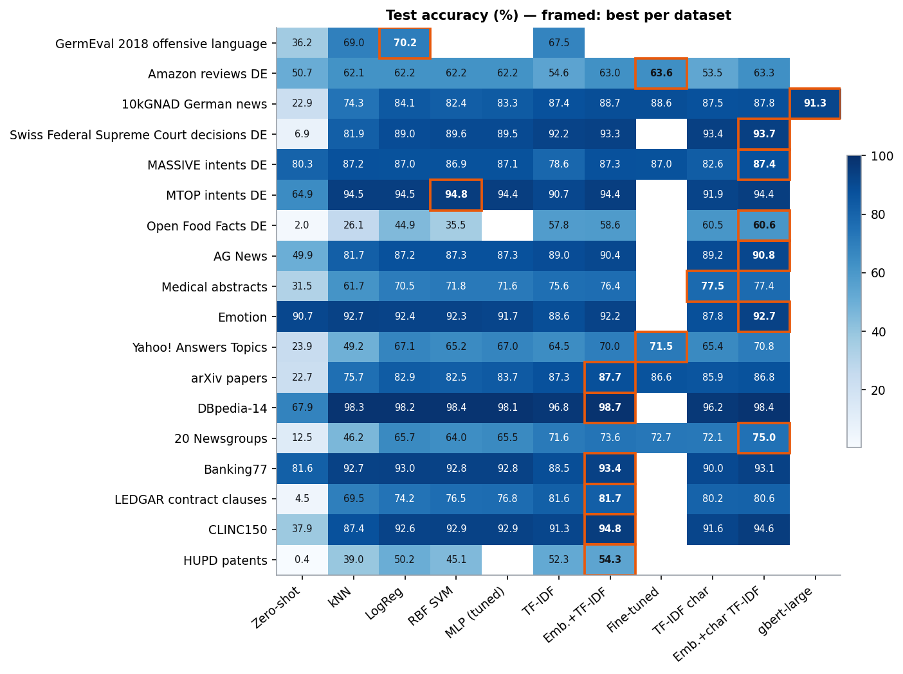
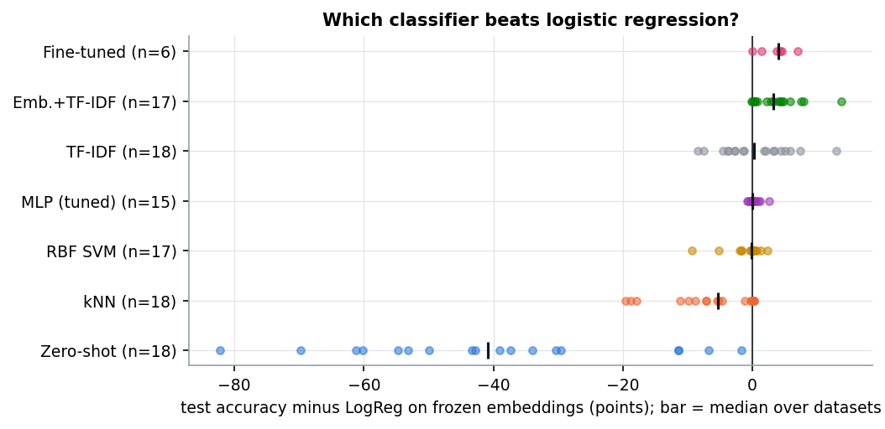
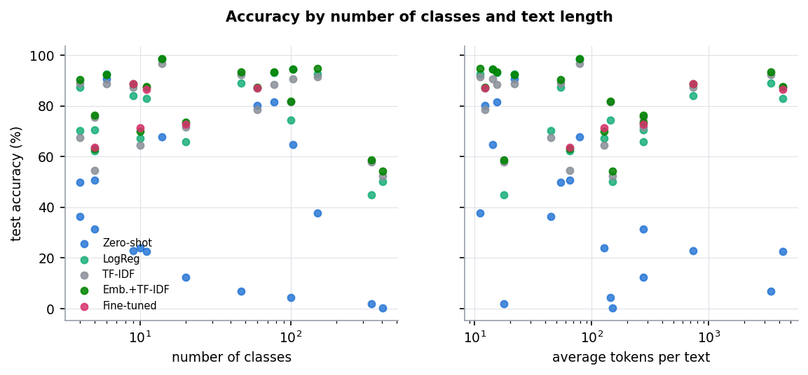
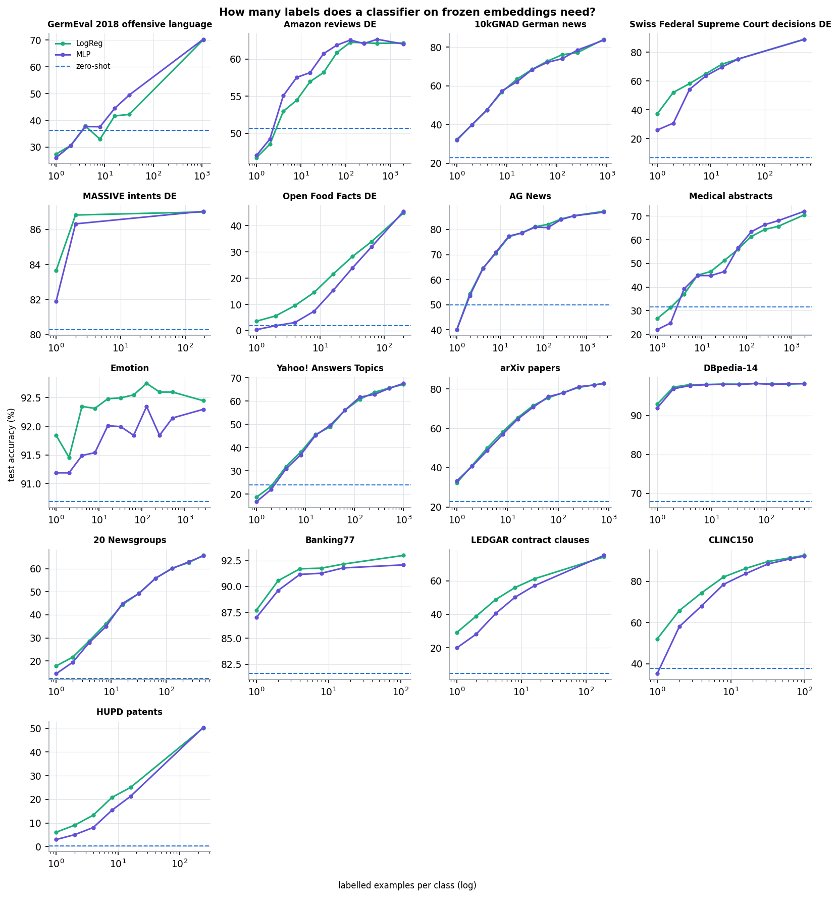
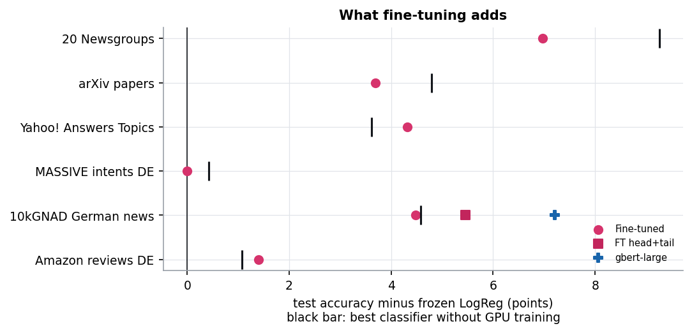
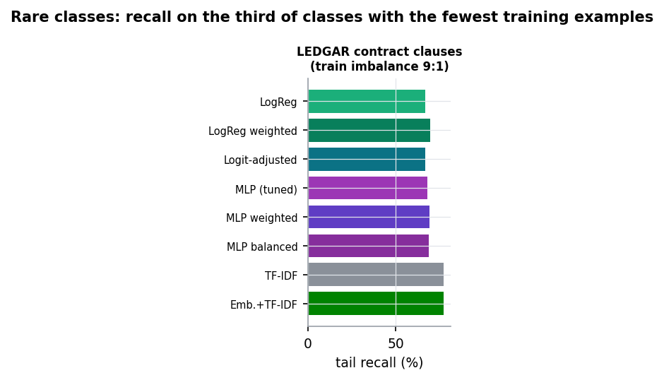
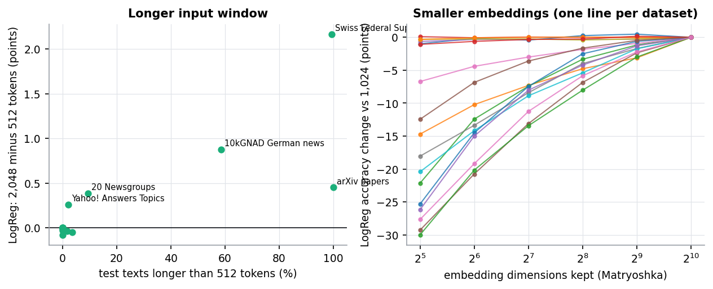

# EmbeddingsBench — findings

**Text classification with `jinaai/jina-embeddings-v5-text-small-classification`: classifiers on frozen embeddings, TF-IDF, ensembles, LoRA fine-tuning and a German-native reference model on 18 English and German datasets.**

Status: interim report, results as of 12 October 2026. Runs still in progress are listed at the end; the numbers here will be updated when they finish. All accuracies are on held-out test splits; every setting (C, k, MLP shape, ensemble weight, fine-tuning checkpoint) was chosen on the validation split only.

## Key findings

1. **Logistic regression is the right default on frozen embeddings.** Across 18 datasets a tuned MLP is on average +0.2 points better (median 0.0), an RBF SVM −0.9, kNN −6.5. A 40-trial MLP architecture search most often picks a linear model.
2. **The cheapest real gain is an ensemble with TF-IDF.** Averaging LogReg probabilities with a word-n-gram TF-IDF SVM is better than LogReg on 12 of 17 datasets, +3.7 points on average, with no GPU training. It matches or beats LoRA fine-tuning on 4 of 6 datasets where both were run.
3. **Frozen embeddings struggle with many fine-grained classes.** With 342 food categories (Open Food Facts DE) LogReg reaches 44.9 % while TF-IDF reaches 57.8 % and the ensemble with character n-grams 60.6 %. For 408 patent classes (HUPD): 50.2 / 52.3 / 54.3 %. Intent datasets with 60–150 classes are the exception (87–95 %), because their classes differ in meaning, not in vocabulary.
4. **Long, technical or legal texts favour lexical features.** On Swiss court decisions, arXiv and LEDGAR, TF-IDF alone beats LogReg on frozen embeddings by 3–7 points and is within 1.5 points of the best method.
5. **LoRA fine-tuning helps most on topical datasets with mid-length texts** (+3.7 to +7.0 points over LogReg on Yahoo! Answers, 20 Newsgroups, 10kGNAD, arXiv), little on short texts with semantic classes (MASSIVE +0.0, Amazon stars +1.4). On 10kGNAD the German-native `gbert-large` (fully fine-tuned) is ahead: 91.3 % vs 88.6 % (89.6 % with head + tail truncation).
6. **Zero-shot (label-name similarity) only works when label names are descriptive**: 91 % on emotions, 82 % on banking intents, under 10 % on legal areas, patents and product categories.
7. **For imbalanced data, class weighting improves the rare classes at no cost in accuracy** (LEDGAR: tail recall 67.0 → 69.8 %, balanced accuracy 71.5 → 72.7 %); logit adjustment selected τ = 0, i.e. no change.
8. **2,048-token input only matters when most texts are long** (Swiss decisions +2.2, 10kGNAD +0.9, arXiv +0.5 points vs 512 tokens). **Matryoshka truncation to 512 dimensions costs 1.1 points on average** (at most 3.1), 256 dimensions 2.9 points.

## Setup

- **Encoder:** `jinaai/jina-embeddings-v5-text-small-classification` (revision `4447914`), last-token pooling, L2-normalised 1,024-d embeddings, prompt `Document: `, up to 2,048 tokens.
- **Classifiers on frozen embeddings:** zero-shot (cosine similarity to label-name embeddings), kNN (cosine, k tuned), logistic regression (C tuned), RBF SVM, MLP (1–2 GELU layers) and a 40-trial MLP architecture search.
- **Text baselines:** TF-IDF (word 1–2-grams, sublinear tf) with a linear SVM; character 2–5-gram TF-IDF.
- **Ensembles:** weighted average of LogReg probabilities and softmaxed TF-IDF scores; weight and temperature chosen on validation.
- **Fine-tuning:** LoRA rank 16 on all attention and MLP projections, linear head initialised from the frozen LogReg, 3 epochs, 512 tokens (variants: 1,024 tokens, head + tail truncation, class-weighted and logit-adjusted loss). `deepset/gbert-large` fully fine-tuned as a German reference.
- **Metrics:** accuracy, balanced accuracy, macro-F1, MCC, Cohen's κ, top-3 accuracy and tail recall (recall on the third of classes with the fewest training examples).
- **Hardware:** one RTX 3060 (12 GB), shared with other services.

## Datasets

| Dataset | Lang | Domain | Classes | Train / val / test | Avg tokens | Train imbalance |
|---|---|---|---|---|---|---|
| GermEval 2018 offensive language | DE | tweets (offensive language) | 4 | 4,258 / 751 / 3,398 | 45 | 47:1 |
| Amazon reviews DE (stars) | DE | product reviews (sentiment) | 5 | 10,000 / 5,000 / 4,999 | 65 | 1:1 |
| 10kGNAD German news | DE | news | 9 | 7,860 / 1,384 / 1,027 | 732 | 3:1 |
| Swiss Federal Supreme Court decisions DE (legal area) | DE | court decisions | 47 | 25,737 / 3,002 / 3,002 | 3413 | 19:1 |
| MASSIVE intents DE | DE | assistant intents | 60 | 11,514 / 1,943 / 2,845 | 12 | 202:1 |
| MTOP intents DE | DE | assistant intents (long tail) | 103 | 11,072 / 1,956 / 1,756 | 14 | 1175:1 |
| Open Food Facts DE (product categories) | DE | food products | 342 | 69,366 / 8,790 / 8,790 | 18 | 12:1 |
| AG News | EN | news | 4 | 10,000 / 2,000 / 7,599 | 54 | 1:1 |
| Medical abstracts | EN | medical | 5 | 9,817 / 1,221 / 1,878 | 274 | 3:1 |
| Emotion (tweets) | EN | emotion (tweets) | 6 | 16,000 / 1,995 / 1,986 | 22 | 9:1 |
| Yahoo! Answers Topics | EN | community Q&A | 10 | 10,000 / 2,000 / 5,000 | 127 | 1:1 |
| arXiv papers (11 categories) | EN | scientific papers | 11 | 8,800 / 2,446 / 2,441 | 4300 | 1:1 |
| DBpedia-14 | EN | encyclopedia | 14 | 7,000 / 1,400 / 2,800 | 79 | 1:1 |
| 20 Newsgroups | EN | forum posts | 20 | 9,361 / 1,644 / 7,299 | 275 | 2:1 |
| Banking77 | EN | banking intents | 77 | 8,497 / 1,496 / 3,069 | 15 | 5:1 |
| LEDGAR contract clauses (LexGLUE) | EN | legal contracts | 100 | 19,092 / 9,914 / 9,855 | 144 | 9:1 |
| CLINC150 (in-scope) | EN | assistant intents | 150 | 15,000 / 2,997 / 4,498 | 11 | 1:1 |
| HUPD patents (IPC subclass) | EN | patents (603-way long tail) | 408 | 98,195 / 18,934 / 18,901 | 151 | 50:1 |

Splits are fixed and stratified where the source has none; large sources are capped per class (see `bench/data.py`). Train imbalance is the ratio of the largest to the smallest class in the training split.

## Overview

| Dataset | Classes | Zero-shot | kNN | LogReg | MLP | TF-IDF | Emb.+TF-IDF | Best (method) | Macro-F1 of best |
|---|---|---|---|---|---|---|---|---|---|
| GermEval 2018 offensive language | 4 | 36.2 | 69.0 | 70.2 | 70.3 | 67.5 | – | **70.3** (MLP) | 37.1 |
| Amazon reviews DE | 5 | 50.7 | 62.1 | 62.2 | 62.2 | 54.6 | 63.0 | **63.6** (Fine-tuned jina) | 63.1 |
| 10kGNAD German news | 9 | 22.9 | 74.3 | 84.1 | 83.3 | 87.4 | 88.7 | **91.3** (gbert-large) | 91.2 |
| Swiss Federal Supreme Court decisions DE | 47 | 6.9 | 81.9 | 89.0 | 89.5 | 92.2 | 93.3 | **93.7** (Emb.+char TF-IDF) | 89.4 |
| MASSIVE intents DE | 60 | 80.3 | 87.2 | 87.0 | 87.1 | 78.6 | 87.3 | **87.4** (Emb.+char TF-IDF) | 83.5 |
| MTOP intents DE | 103 | 64.9 | 94.5 | 94.5 | 94.4 | 90.7 | 94.4 | **94.8** (RBF SVM) | 83.2 |
| Open Food Facts DE | 342 | 2.0 | 26.1 | 44.9 | 45.4 | 57.8 | 58.6 | **60.6** (Emb.+char TF-IDF) | 56.9 |
| AG News | 4 | 49.9 | 81.7 | 87.2 | 87.3 | 89.0 | 90.4 | **90.8** (Emb.+char TF-IDF) | 90.7 |
| Medical abstracts | 5 | 31.5 | 61.7 | 70.5 | 71.6 | 75.6 | 76.4 | **77.5** (TF-IDF char) | 77.2 |
| Emotion | 6 | 90.7 | 92.7 | 92.4 | 91.7 | 88.6 | 92.2 | **92.7** (Emb.+char TF-IDF) | 88.1 |
| Yahoo! Answers Topics | 10 | 23.9 | 49.2 | 67.1 | 67.0 | 64.5 | 70.0 | **71.5** (Fine-tuned jina) | 71.2 |
| arXiv papers | 11 | 22.7 | 75.7 | 82.9 | 83.7 | 87.3 | 87.7 | **87.7** (Emb.+TF-IDF) | 87.0 |
| DBpedia-14 | 14 | 67.9 | 98.3 | 98.2 | 98.1 | 96.8 | 98.7 | **98.7** (Emb.+TF-IDF) | 98.7 |
| 20 Newsgroups | 20 | 12.5 | 46.2 | 65.7 | 65.5 | 71.6 | 73.6 | **75.0** (Emb.+char TF-IDF) | 73.4 |
| Banking77 | 77 | 81.6 | 92.7 | 93.0 | 92.8 | 88.5 | 93.4 | **93.4** (Emb.+TF-IDF) | 93.3 |
| LEDGAR contract clauses | 100 | 4.5 | 69.5 | 74.2 | 76.8 | 81.6 | 81.7 | **81.7** (Emb.+TF-IDF) | 77.6 |
| CLINC150 | 150 | 37.9 | 87.4 | 92.6 | 92.9 | 91.3 | 94.8 | **94.8** (Emb.+TF-IDF) | 94.8 |
| HUPD patents | 408 | 0.4 | 39.0 | 50.2 | 50.4 | 52.3 | 54.3 | **54.3** (Emb.+TF-IDF) | 38.7 |

The best method per dataset is picked by test accuracy for this overview; each method's own settings were chosen on validation. On GermEval 2018 and the long-tail sets (MTOP, HUPD), macro-F1 is far below accuracy: the majority classes dominate accuracy.

## Classifiers on top of the embeddings

Test accuracy difference to LogReg on frozen embeddings, in points:

| Classifier | Mean Δ (pts) | Median Δ (pts) | Better by > 0.5 pts | Datasets |
|---|---|---|---|---|
| Emb.+TF-IDF | +3.7 | +3.2 | 12 | 17 |
| Fine-tuned | +3.5 | +4.0 | 5 | 6 |
| TF-IDF | +0.5 | +0.3 | 9 | 18 |
| MLP (tuned) | +0.2 | +0.0 | 3 | 15 |
| RBF SVM | -0.9 | -0.1 | 3 | 17 |
| kNN | -6.5 | -5.3 | 0 | 18 |
| Zero-shot | -39.9 | -40.9 | 0 | 18 |

- **LogReg vs MLP:** the embeddings are already linearly separable where they separate at all. MLPs win by 1–2 points only on a few datasets with larger training sets (LEDGAR +2.6 tuned, Medical abstracts +1.1) and lose on small or many-class sets; the search mostly chose depth 0.
- **RBF SVM:** never clearly better than LogReg, slower to train (a 30k subsample was needed above 30k training texts) and on Open Food Facts 9 points worse.
- **kNN:** competitive on intents and emotions (within 0.5 points of LogReg on Banking77, MTOP, MASSIVE, Emotion), weak on topical and many-class data (−18 points on Yahoo!, −19 on Open Food Facts).
- **Zero-shot:** useful as a no-label starting point only where label names describe the class well.

## Number of classes and text length

Accuracy on frozen embeddings drops sharply above about 150 classes, while TF-IDF degrades less: a single 1,024-d embedding appears to blur fine distinctions between neighbouring product or patent categories that specific words and word parts still separate. Text length alone is not the driver: short intent texts are classified well and short product names badly.

## How many labels are needed

With 8–16 examples per class, LogReg on frozen embeddings already reaches most of its full-data accuracy on intent, emotion and encyclopedia data (Banking77 ~92 % at 16 per class, DBpedia ~98 % at 4). Topical and many-class datasets keep improving up to the full training set; there, more labels pay off more than a different classifier. LogReg is mostly ahead of the MLP at small sample sizes.

## Fine-tuning

| Dataset | Frozen LogReg | Best without GPU training | Fine-tuned jina (LoRA) | Variant | gbert-large | Training time |
|---|---|---|---|---|---|---|
| Yahoo! Answers | 67.1 | 70.8 | **71.5** | – | – | 39 min |
| 20 Newsgroups | 65.7 | **75.0** | 72.7 | – | – | 46 min |
| arXiv (11) | 82.9 | **87.7** | 86.6 | – | – | 150 min |
| 10kGNAD | 84.1 | 88.7 | 88.6 | 89.6 (head + tail) | **91.3** | 76 / 95 / 29 min |
| Amazon reviews DE | 62.2 | 63.3 | **63.6** | – | running | 37 min |
| MASSIVE DE | 87.0 | **87.4** | 87.0 | – | queued | 26 min |

- Fine-tuning pays off where classes are topical and the frozen embedding is not tuned to the distinction (Yahoo!, 20NG, news). On MASSIVE the best checkpoint was step 0, i.e. the untouched encoder.
- Where lexical cues matter (20NG, arXiv), the embedding + TF-IDF ensemble beats the fine-tuned encoder without any GPU training; the fine-tuned + TF-IDF ensemble is being computed.
- Keeping the end of long German news articles (head + tail: first 384 + last 128 tokens) adds 1.0 point over the first 512 tokens.
- `gbert-large` (335M parameters, all weights trained, 8-bit AdamW, about 4 GB of GPU memory) beat LoRA on jina by 2.7 points on 10kGNAD in less than half the training time; Amazon DE and MASSIVE DE follow.

## Class imbalance

**LEDGAR contract clauses (LexGLUE)**, %

| Classifier | Accuracy | Balanced acc. | Macro-F1 | Tail recall |
|---|---|---|---|---|
| LogReg | 74.2 | 71.5 | 68.3 | 67.0 |
| LogReg weighted | 74.1 | 72.7 | 68.8 | 69.8 |
| Logit-adjusted | 74.2 | 71.5 | 68.3 | 67.0 |
| MLP (tuned) | 76.8 | 72.6 | 69.7 | 68.1 |
| MLP weighted | 76.4 | 72.7 | 69.3 | 69.2 |
| MLP balanced | 74.5 | 71.8 | 68.4 | 68.8 |
| TF-IDF | 81.6 | 80.0 | 77.5 | 77.4 |
| Emb.+TF-IDF | 81.7 | 80.1 | 77.6 | 77.4 |

On LEDGAR (100 clause types, training set capped at 200 per class, 9:1 imbalance), class-weighted LogReg raises recall on the rarest third of classes by 2.8 points and balanced accuracy by 1.2 points without losing accuracy. Logit adjustment chose τ = 0 on validation. The lexical model is the strongest on rare classes here (tail recall 77.4 %). Imbalance schemes on MTOP (1175:1), Swiss decisions, Open Food Facts and HUPD, including class-weighted and logit-adjusted fine-tuning, are running.

## Input length and embedding size

The longer window helps only in proportion to how many texts exceed 512 tokens. Matryoshka truncation: 512 dimensions −1.1 points on average (worst −3.1), 256 −2.9, 128 −5.5. The loss below 256 dimensions varies widely between datasets (see the figure).

## Cost

Embedding runs at about 12,700 tokens/s and LoRA fine-tuning at about 1,900 tokens/s on the shared RTX 3060; both scale with tokens, not with the number of classes. LogReg, kNN and TF-IDF train in seconds to minutes on CPU, except TF-IDF with character n-grams on large many-class sets (HUPD: more than 11 GB of RAM, skipped).

## Recommendations

**Default pipeline.** Embed once, train LogReg (tune C on a validation split), and add a TF-IDF SVM in a probability ensemble. That is the best or within a point of the best on most datasets, costs one embedding pass, and retrains in minutes when labels change.

**Larger datasets (≫ 10k training texts).**
- Embed once and keep the embeddings: classifier experiments then cost CPU minutes, not GPU hours.
- Fit LogReg with a fast solver (SAGA or a GPU softmax layer) and a coarse C grid; subsample for SVMs and for hyper-parameter search.
- An MLP becomes worth trying above roughly 20k training texts (LEDGAR +2.6 points), still with a 1-layer default.
- Fine-tune only on a capped subset first (e.g. 1,000 per class): the learning curves show diminishing returns, and fine-tuning time grows linearly with tokens.
- Use 512-d Matryoshka embeddings when storage or kNN search matters; budget about 1 point of accuracy.

**Many classes (> 100–150).**
- Do not rely on frozen embeddings alone: always include TF-IDF (word and character n-grams) and the ensemble; on 342 and 408 classes it was 4–16 points ahead of LogReg.
- Report balanced accuracy, macro-F1 and top-3 alongside accuracy; macro-F1 on HUPD is 16 points below accuracy.
- Make sure each class has enough examples (≥ 20, ideally ≥ 100); merge or drop catch-all and near-duplicate categories (as done for Open Food Facts).
- Consider a hierarchy: predict the parent category first (e.g. the IPC class), then the subclass among its children.
- Use class weighting, and check tail recall.
- Zero-shot and kNN are not viable at this scale.

**Short texts with semantic classes (intents, emotions).** Frozen embeddings + LogReg are enough (87–95 %); kNN is a good alternative when classes change often, because no retraining is needed. Fine-tuning brings little.

**Long documents.** Use the 2,048-token window (or head + tail when fine-tuning) and combine with TF-IDF; legal and scientific texts carry much of their signal in vocabulary.

**German.** jina v5 handles German well on frozen embeddings, but for a fine-tuned German classifier a German-native encoder (`gbert-large`) was stronger in the first comparison.

**Imbalanced data.** Start with class-weighted LogReg (free), measure tail recall, and only then try logit adjustment or weighted fine-tuning.

## Still running

- gbert-large on Amazon reviews DE and MASSIVE DE.
- MLP search, imbalance schemes, GermEval extras on the new datasets.
- 10kGNAD fine-tuning with 1,024 tokens; fine-tuned + TF-IDF ensembles.
- Fine-tuning (plain, class-weighted, logit-adjusted) on MTOP and Swiss decisions.

## Reproduce

Code, data preparation and all raw results are in this repository: `results/results.json` (every number above, incl. per-setting validation scores), `bench/` (pipeline), `bench/report.py` (these figures and tables). See the README for setup and the GPU server configuration.
